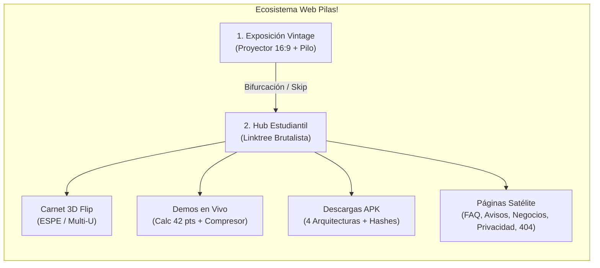
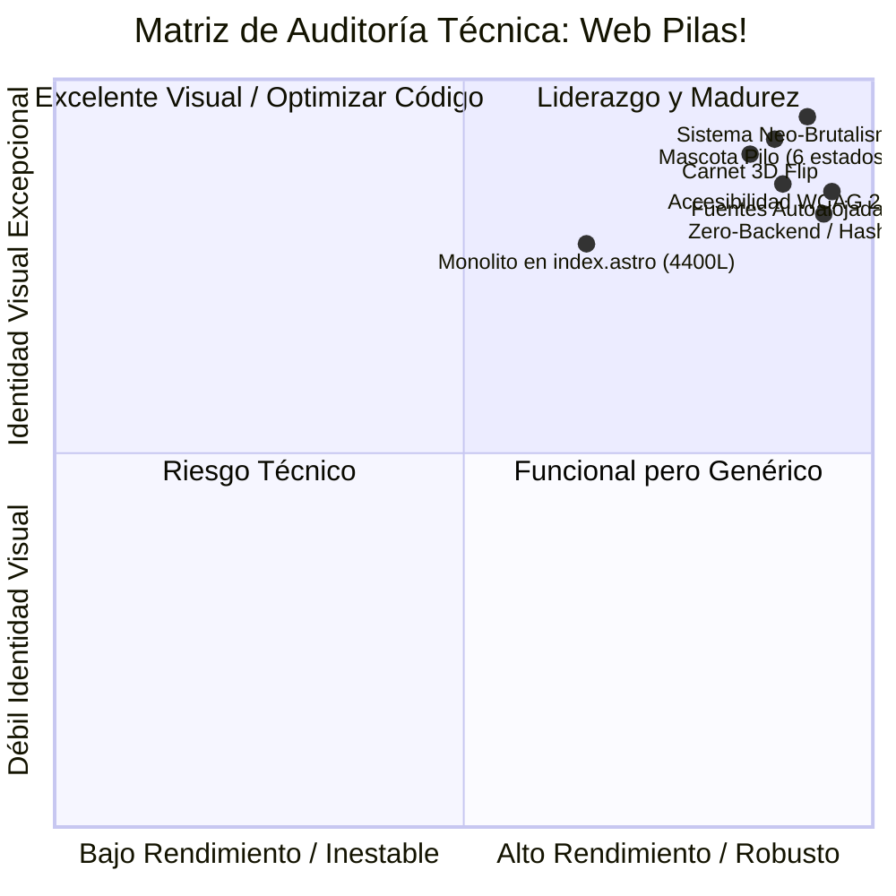

# 📋 Informe Técnico de Auditoría: Estado Actual de la Web — PILAS!
**Sistema de Diseño: Neo-Student Brutalism (Edición Fucsia & Sticker v2.2.0)**  
**Proyecto:** *Pilas! — Software Estudiantil para la ESPE y Universidades de Ecuador*  
**Fecha de Emisión:** 27 de octubre de 2026  
**Entorno de Despliegue:** Producción / Vercel (`pilas-ec.vercel.app`)  
**Stack de Desarrollo:** Astro 7.3.5, TypeScript 6.0, GSAP 3.15, Vanilla CSS3 (Custom Properties), Fonts Autoalojadas  

---

## 📑 Tabla de Contenidos
1. [Resumen Ejecutivo & Ficha Técnica](#1-resumen-ejecutivo--ficha-técnica)
2. [Filosofía y ADN Estético: Neo-Student Brutalism](#2-filosofía-y-adn-estético-neo-student-brutalism)
3. [Paleta Cromática, Tokens CSS & Accesibilidad WCAG](#3-paleta-cromática-tokens-css--accesibilidad-wcag)
4. [Sistema Tipográfico & Fuentes Autoalojadas](#4-sistema-tipográfico--fuentes-autoalojadas)
5. [Identidad Visual: Logotipo Neón, Mascota & Carnet 3D](#5-identidad-visual-logotipo-neón-mascota--carnet-3d)
6. [Disposición, Estructura & Arquitectura de Páginas (Layout)](#6-disposición-estructura--arquitectura-de-páginas-layout)
   - [6.1 Landing Page Dual (`index.astro`): La Exposición Vintage + El Hub](#61-landing-page-dual-indexastro-la-exposición-vintage--el-hub)
   - [6.2 Centro de Ayuda y Preguntas Frecuentes (`faq.astro`)](#62-centro-de-ayuda-y-preguntas-frecuentes-faqastro)
   - [6.3 Tablón de la Comunidad en Vivo (`avisos.astro`)](#63-tablón-de-la-comunidad-en-vivo-avisosastro)
   - [6.4 Directorio de Negocios y Servicios (`negocios.astro`)](#64-directorio-de-negocios-y-servicios-negociosastro)
   - [6.5 Manifiesto de Privacidad Radical Zero-Backend (`privacidad.astro`)](#65-manifiesto-de-privacidad-radical-zero-backend-privacidadastro)
   - [6.6 Error 404 Divertido con Arcade Minijuego (`404.astro`)](#66-error-404-divertido-con-arcade-minijuego-404astro)
   - [6.7 Enrutadores de Redirección Inteligente (`espe.astro`, `multi-u.astro`)](#67-enrutadores-de-redirección-inteligente-espeastro-multi-uastro)
7. [Catálogo de Componentes & Demos Interactivas](#7-catálogo-de-componentes--demos-interactivas)
8. [Físicas, Microinteracciones & Animaciones Hápticas](#8-físicas-microinteracciones--animaciones-hápticas)
9. [Copywriting, Tono de Voz & Jerga Estudiantil](#9-copywriting-tono-de-voz--jerga-estudiantil)
10. [Diagnóstico de Calidad, Fortalezas & Recomendaciones](#10-diagnóstico-de-calidad-fortalezas--recomendaciones)

---

## 1. Resumen Ejecutivo & Ficha Técnica

El presente documento constituye un informe exhaustivo de auditoría técnica, visual y funcional de la plataforma web de **Pilas!** (`pilas-web`). 

La web cumple una función estratégica triple:
1. **Canal Oficial de Distribución Directa (APK)**: Entrega de paquetes compilados con verificación criptográfica SHA-256 por arquitectura (ARM64-v8a, ARMeabi-v7a, Universal, x86_64).
2. **Experiencia de Onboarding & Gamificación ("La Exposición Vintage")**: Una presentación teatralizada con estética de proyector analógico que educa al alumno sobre los dolores universitarios reales y bifurca la experiencia según su institución.
3. **Hub Estudiantil de Alta Conversión ("Linktree Brutalista")**: Un portal rápido que centraliza el carnet 3D interactivo, calculadoras académicas en vivo, compresores de documentos, directorios comunitarios y manifiesto de privacidad Zero-Backend.



### Tabla de Datos Técnicos de Producción
| Parámetro | Valor Actual en Producción | Observación |
| :--- | :--- | :--- |
| **Versión del Producto** | `v1.2.0` (Build `8`) | Sincronizado en `site.ts`, `index.astro` y metadatos JSON-LD |
| **Versión del APK Distribuido** | `v1.1-beta.2` | Tamaño: `37.2 MB` (ARM64-v8a) |
| **Motor Web** | [Astro](https://astro.build/) `v7.3.5` | Generación estática (SSG) de máxima velocidad y 0 JS innecesario |
| **Estilos & Layout** | Vanilla CSS con Custom Properties | Sin Tailwind ni dependencias CSS complejas |
| **Animación Principal** | GSAP `v3.15.0` + CSS Keyframes | Control fino de la línea de tiempo en el proyector de diapositivas |
| **Tipografías** | Autoalojadas en `/fonts/` (`.woff2`) | Sin conexiones externas a Google Fonts (Privacidad + Cero CLS) |
| **Seguridad de Servidor** | Arquitectura Zero-Backend | No recopila credenciales ni telemetría en base de datos externa |
| **Descargas Comunitarias** | `+100` verificadas | Comunidad activa de la ESPE Sangolquí y sedes |

---

## 2. Filosofía y ADN Estético: Neo-Student Brutalism

El diseño visual de **Pilas!** no obedece a un tema corporativo genérico. Implementa un sistema de diseño propio denominado **Neo-Student Brutalism (Edición Fucsia & Sticker v2.2.0)**, diseñado para conectar con la juventud universitaria ecuatoriana.

### Pilares Fundamentales del Diseño:
1. **Fucsia Pop como Insignia (`#FF3FA4`)**: Rompe deliberadamente con los azules corporativos aburridos o los verdes burocráticos tradicionales de las universidades. El fucsia transmite energía, frescura y juventud ("¡Pilas!").
2. **El Verde es Exclusivo de Éxito (`#00FF87`)**: Se respeta una regla semántica inviolable: el verde **sólo** significa materia aprobada ($\ge 14.00/20$), tarea entregada o clase en vivo. Jamás se utiliza como mero color de adorno corporativo.
3. **Dark-Mode First (Lienzo Slate y OLED)**: Fondos oscuros (`#101319` en base, `#161A23` en tarjetas) diseñados para largas jornadas de estudio nocturno y ahorro de batería en pantallas AMOLED de smartphones.
4. **Cultura Cartoon & Sticker**: Contornos negros sólidos de 1.5 a 2 px, esquinas redondeadas pero firmes (`border-radius: 12px-16px`), pastillas estilo pegatina (`.sticker-pill`) y sombras ortogonales duras sin difuminado (`box-shadow: 4px 4px 0 #000`).
5. **Dualidad Funcional de Campus**:
   - **Modo ESPE**: Acento Fucsia (`#FF3FA4`), fondo con cuadrícula ortogonal técnica de malla curricular (`32px 32px`), terminología de Bloques (A-H), ID Banner y regla de 42 puntos.
   - **Modo Multi-Universidad**: Acento Coral (`#FF3D5E`), fondo con trama de puntos radiales tipo libreta universitaria (`22px 22px`), terminología universal de Moodle, calificador 10/20/100 y escudos personalizables.

---

## 3. Paleta Cromática, Tokens CSS & Accesibilidad WCAG

Los tokens están sincronizados entre los portales web (`global.css` y estilos embebidos de página) y la aplicación móvil Flutter (`AppColors`).

### 3.1 Tokens Oficiales de Color

| Token CSS | Hexadecimal | Nombre Semántico | Rol y Aplicación en la Web |
| :--- | :---: | :--- | :--- |
| `--color-primary` | `#FF3FA4` | **Fucsia Pop** | Botón primario, logo neón, tabs activos, focus rings y acentos de marca. |
| `--color-primary-hover` | `#E5147D` | Fucsia Hover | Estado presionado y punto medio del haz de luz proyector. |
| `--color-primary-extrude` | `#7A0A45` | Fucsia Oscuro | Relieve inferior de botones y extrusiones tipográficas. |
| `--color-primary-shadow` | `#4A0026` | Fucsia Sombra | Sombra dura brutalista sobre fondos oscuros. |
| `--color-primary-coral` | `#FF3D5E` | Coral Multi-U | Acento secundario y color temático del Modo Multi-Universidad. |
| `--color-success` | `#00FF87` | **Verde Aprobado** | Materia aprobada ($\ge 14.0$), chips en vivo, pulso de descargas. |
| `--color-success-shadow` | `#059669` | Verde Sombra | Sombra ortogonal de elementos en estado aprobado. |
| `--color-warning` | `#FFDB60` | **Ámbar Urgente** | Tareas por vencer (< 24h), avisos y advertencias de supletorio. |
| `--color-critical` | `#EF4444` | **Rojo Crítico** | Materia reprobada, MiESPE caído, alertas de error 404. |
| `--color-info` | `#38BDF8` | **Cian Técnico** | Enlaces, chips informativos, badges Zero-Backend y herramientas PDF. |
| `--color-bg-base` | `#101319` | Dark Slate Base | Fondo principal del lienzo (body) en Modo ESPE. |
| `--color-bg-subtle` | `#191D28` | Slate Suave | Fondo principal del lienzo en Modo Multi-Universidad. |
| `--color-bg-surface` | `#161A23` | Superficie Tarjeta | Fondo de tarjetas (`.card`, `.card-app`), modales y diálogos. |
| `--color-bg-elevated` | `#1E2230` | Superficie Elevada | Botones secundarios, inputs de formulario, cajas de slider. |
| `--color-bg-container` | `#242938` | Contenedor Alto | Encabezados de tablas, paneles flotantes. |
| `--color-border` | `#2A3142` | Borde Estructural | Línea de separación de tarjetas y cuadrículas. |
| `--color-border-control` | `#6B7894` | Borde de Control | Borde de inputs, botones secundarios y toggles (cumple $\ge 3:1$). |
| `--color-text-title` | `#FAF7F7` | Blanco Cálido | Títulos principales (`h1`, `h2`), cifras numéricas y badges destacados. |
| `--color-text-body` | `#E1E2EB` | Gris Neutro Claro | Párrafos descriptivos, etiquetas de control y explicaciones. |
| `--color-text-muted` | `#8F9CAE` | Gris Muted | Placeholders, leyendas legales, números de versión y breadcrumbs. |

### 3.2 Tabla de Contraste Calculado (WCAG 2.1)

Todos los pares de color han sido auditados mediante luminancia relativa para garantizar el cumplimiento con las directrices de accesibilidad:

| Combinación de Elemento | Primer Plano | Fondo | Ratio Calculado | Nivel WCAG | Veredicto Técnico |
| :--- | :---: | :---: | :---: | :---: | :--- |
| **Texto de Título** | `#FAF7F7` | `#101319` (Base) | **17.46:1** | AAA | Contraste superlativo; lectura sin fatiga. |
| **Texto de Tarjeta** | `#FAF7F7` | `#161A23` (Superficie) | **16.34:1** | AAA | Máxima legibilidad en tarjetas. |
| **Cuerpo de Párrafo** | `#E1E2EB` | `#161A23` (Superficie) | **13.50:1** | AAA | Lectura cómoda en bloques extensos. |
| **Texto en Inputs** | `#E1E2EB` | `#1E2230` (Elevado) | **12.27:1** | AAA | Excelente visibilidad de controles. |
| **Texto Muted / Meta** | `#8F9CAE` | `#161A23` (Superficie) | **6.25:1** | AA | Supera el umbral normal de 4.5:1. |
| **Botón Primario (Fucsia)** | `#000000` | `#FF3FA4` | **6.50:1** | **AA** | **Texto negro obligatorio sobre fucsia.** |
| *Texto Blanco sobre Fucsia* | `#FFFFFF` | `#FF3FA4` | *3.23:1* | *Falla* | **Prohibido.** Texto blanco sobre fucsia no pasa WCAG. |
| **Botón Éxito (Verde)** | `#00210C` | `#00FF87` | **14.80:1** | AAA | Texto verde oscuro de altísimo contraste. |
| **Botón Ámbar (Alerta)** | `#2A1C00` | `#FFDB60` | **12.50:1** | AAA | Texto oscuro sobre fondo de advertencia. |

---

## 4. Sistema Tipográfico & Fuentes Autoalojadas

Para eliminar el bloqueo de renderizado, evitar llamadas de telemetría a servidores de terceros y prevenir variaciones acumulativas de diseño (CLS = 0), la web de Pilas! aloja sus propias fuentes en `/public/fonts/`.

### Especificación de Familias

```
┌────────────────────────────────────────────────────────────────────────┐
│  Outfit Variable (400, 600, 700, 800, 900)                             │
│  → Titulares (h1, h2, h3), botones de acción (.btn), stickers (.badge) │
├────────────────────────────────────────────────────────────────────────┤
│  Inter Variable (400, 500, 600)                                        │
│  → Cuerpo de texto principal, explicaciones técnicas, diálogos         │
├────────────────────────────────────────────────────────────────────────┤
│  JetBrains Mono / ui-monospace (700, 800)                              │
│  → Códigos de aula, NRCs, Hashes SHA-256, números de versión           │
├────────────────────────────────────────────────────────────────────────┤
│  Special Elite (400)                                                   │
│  → Subtítulos tipo máquina de escribir en el proyector retro           │
└────────────────────────────────────────────────────────────────────────┘
```

### Reglas Tipográficas Avanzadas Implementadas:
- **`text-wrap: balance`**: Aplicado en `h1`, `h2` y `h3` para evitar líneas descompensadas o palabras solitarias (huérfanas) en pantallas móviles y monitores ultrawide.
- **`text-wrap: pretty`**: Aplicado en `p` y `blockquote` para una distribución estética óptima de párrafos largos.
- **`font-variant-numeric: tabular-nums`**: Aplicado en la clase `.num` para que las notas académicas (ej. `14.00`, `20.00`), tamaños de archivo (`37.2 MB`) y horas se alineen con exactitud decimal vertical.

---

## 5. Identidad Visual: Logotipo Neón, Mascota & Carnet 3D

### 5.1 Logotipo Oficial con Brillo Neón Fucsia (CSS Glow)
El logotipo de Pilas! utiliza la tipografía de letras transparentes vectoriales (`/logos/letras_estilo_transparente.svg`) sin fondos de caja duros que ensucien la cabecera.

Se implementa una propiedad de iluminación multicapa que emite un halo fosforescente fucsia continuo:
```css
filter: drop-shadow(0 0 10px rgba(255, 63, 164, 0.95))
        drop-shadow(0 0 22px rgba(255, 20, 117, 0.75))
        drop-shadow(0 0 38px rgba(255, 63, 164, 0.45))
        drop-shadow(2px 3px 0 #000000);
animation: logoPinkGlowPulse 4s ease-in-out infinite;
```

### 5.2 La Mascota Oficial: "Pilo" (6 Estados Emocionales)
Pilo no es un adorno decorativo; actúa como el guía interactivo del estudiante a lo largo de toda la web:

| Estado | Archivo SVG | Expresión Visual | Significado & Uso en la Web |
| :---: | :--- | :--- | :--- |
| **Neutro** | `mascota_neutro.svg` | Ojos atentos, sonrisa amable | Estado base en diálogos, carnet ESPE y cabeceras generales. |
| **Aprobación** | `mascota_aprobacion.svg` | Sonrisa radiante, pulgar arriba | Celebración en calculadora ($\ge 14.0$), build verificado, APK libre de virus. |
| **Negación** | `mascota_negacion.svg` | Ceño fruncido, pulgar abajo | Página de error 404 ("¡Chuta!"), materia en supletorio o error de red. |
| **Asustado** | `mascota_asustado.svg` | Ojos desorbitados, sudor frío | Alerta en compresor cuando el PDF supera los 5 MB de Moodle; MiESPE caído. |
| **Dormido** | `mascota_dormido.svg` | Gorro de dormir, zzz plácido | Estado vacío en tablón de avisos cuando no hay novedades pendientes. |
| **Policía** | `mascota_policia.svg` | Gorra de guardia, gafas oscuras | Bloque de Privacidad Radical Zero-Backend y protección Keystore AES-256. |

### 5.3 Carnet Estudiantil 3D Interactivo (Doble Faz)
En el Hero del Hub Estudiantil se exhibe una credencial estudiantil tridimensional desarrollada con CSS 3D Transforms (`perspective: 1000px`, `transform-style: preserve-3d`). Al hacer clic o tocar la tarjeta, se ejecuta un giro de 180°:
- **Cara Frontal (Modo ESPE)**: Encabezado oficial verde-fucsia de la ESPE, avatar de Pilo con badge "OFICIAL", sede Matriz Sangolquí, datos de aulas A-H, 23 mallas, tira holográfica de chip garita y código de barras legible con ID Banner `L00412890`.
- **Cara Posterior (Modo Multi-U)**: Encabezado Red Ecuador, avatar de Pilo con badge "UNIVERSAL", acceso Moodle Mobile instantáneo con código QR dinámico de alta resolución.

---

## 6. Disposición, Estructura & Arquitectura de Páginas (Layout)

La arquitectura de información de la web se divide en la página principal (`/`), páginas de contenido temático y páginas de soporte.

```
src/pages/
├── index.astro       → Experiencia completa (Exposición Vintage + Hub Estudiantil)
├── faq.astro         → Preguntas Frecuentes con buscador y 6 categorías
├── avisos.astro      → Tablón en tiempo real de la comunidad estudiantil
├── negocios.astro    → Directorio de papelerías, copias y comida en el campus
├── privacidad.astro  → Política de Privacidad & Manifiesto Zero-Backend
├── 404.astro         → Página no encontrada con minijuego interactivo "Corre al Aula"
├── espe.astro        → Redirección con preselección de Modo ESPE (?mode=espe)
└── multi-u.astro     → Redirección con preselección de Modo Multi-U (?mode=multi)
```

---

### 6.1 Landing Page Dual (`index.astro`): La Exposición Vintage + El Hub

`index.astro` integra dos experiencias fluidas que se complementan:

#### Experiencia A: "La Exposición Vintage" (El Proyector)
Al entrar por primera vez (a menos que el usuario tenga `prefers-reduced-motion` o `skip=1`), se abre un modal de proyección cinemática a pantalla completa:
- **Atmósfera Analógica**: Haz de luz con destellos animados (`.beam`), grano y rayas de proyector analógico de diapositivas (`.film`).
- **Línea de Tiempo**: 6 diapositivas secuenciadas con GSAP que cuentan una historia entretenida:
  - *Diapositiva 01*: "¿Por qué existe Pilas?" (La génesis del software independiente).
  - *Diapositiva 02 (Bifurcación)*: El estudiante elige si estudia en la ESPE o en otra universidad del Ecuador.
  - *Diapositiva 03*: "El Dolor del Campus" (MiESPE caído a las 06:58 AM, códigos incomprensibles de aulas, carnet olvidado en garita).
  - *Diapositiva 04*: "La Solución" (Aulas decodificadas a pisos reales, 23 mallas offline / Conexión Moodle por QR en 1 segundo).
  - *Diapositiva 05*: "Las Armas Estudiantiles" (Calculadora de 42 puntos / Detector de tareas 23:59 y carátulas oficiales con escudo).
  - *Diapositiva 06*: "Zero-Backend y Cierre" (Pilo Policía garantiza privacidad absoluta + Botón de acceso al Hub).
- **Subtitulado Retro**: Texto tipeado en vivo simulando voz de presentador con la tipografía `Special Elite`.
- **Controles**: Barra de progreso con medidor de batería (`#imeter`), contador "Diapositiva X de 6", botón de salto rápido y toggle de Modo Retro.

#### Experiencia B: "El Hub Estudiantil" (Linktree Neo-Brutalista)
Al terminar o saltar la presentación, se revela el Hub principal:
1. **Header Flotante**: Lettering con brillo neón, chip de pulso en vivo (`.live-pulse`), indicador del campus activo, botón para repetir la exposición y CTA directo a Descargas.
2. **Hero del Hub**:
   - Titular dinámico que conmuta según el campus:
     - *ESPE*: *"Tu semestre bajo control, aunque MiESPE esté caído"*.
     - *Multi-U*: *"Tu Moodle y tus notas, desde cualquier campus del país"*.
   - Tarjeta de diálogo interactiva de Pilo con citas célebres estudiantiles.
   - Selector de Campus con switch táctil brutalista (ESPE vs Multi-Universidad).
   - El Carnet Estudiantil 3D interactivo con rotación táctil.
3. **Bloque de Reglas del Campus**: 4 tarjetas de alto impacto para cada universidad (traductor de aulas, 23 mallas, 42 puntos, pase garita).
4. **Caja Fuerte Zero-Backend**: Ilustración con Pilo Policía, destacando el cifrado de hardware AES-256 en Android Keystore y la total ausencia de servidores intermediarios.
5. **Centro de Descargas Oficial (APK)**:
   - Badge de versión `v1.2.0`, build `#8`, peso `37.2 MB`.
   - Botón de descarga principal destacado con sombra dura.
   - Enlace secundario para la beta cerrada de Google Play Store.
   - Guía en 3 pasos "anti-susto" para la advertencia estándar de instalación de APK en Android.
   - Desplegable técnico con checksums SHA-256 para las 4 arquitecturas soportadas.
6. **Linktree de Enlaces & Herramientas Clave**: Tarjetas de navegación rápida hacia FAQ, Avisos, Negocios, Privacidad, Instagram oficial (`@pilas_ec.app`) y Canal de WhatsApp.
7. **Demos Interactivas en Vivo**:
   - **Calculadora 42/60 Puntos**: Sliders de Parcial 1 y Parcial 2 que calculan en tiempo real la nota requerida en el Parcial 3, con Pilo reaccionando en vivo (feliz si aprueba o alarmado si entra a supletorio).
   - **Compresor de Archivos para Moodle**: Simulación de reducción de un archivo pesado de 24.8 MB a menos de 4 MB para burlar el límite de 5 MB de la plataforma institucional.
8. **Footer Oficial**: Lettering neón, enlaces institucionales, aviso de independencia legal y copyright.

---

### 6.2 Centro de Ayuda y Preguntas Frecuentes (`faq.astro`)
Diseñado para resolver dudas recurrentes de instalación, compatibilidad y seguridad:
- **Buscador en Tiempo Real**: Filtra preguntas al vuelo mediante input dinámico.
- **Categorización Temática (6 Filtros)**:
  1. *Instalación & APK* (Permisos de fuentes desconocidas, actualizaciones automáticas).
  2. *Seguridad & Cuentas* (Almacenamiento de contraseñas, por qué no hay robo de datos).
  3. *Moodle & Tareas* (Vinculación por QR, límite de 5 MB, alertas de entrega).
  4. *Horario, Aulas & Notas* (Decodificación de pisos, cálculo de 42 puntos).
  5. *Malla & Modo Offline* (23 carreras, prerrequisitos, uso sin datos móviles).
  6. *General, Sedes & iPhone* (Latacunga, Santo Domingo, versión iOS futura).
- **SEO Estructurado**: Integra JSON-LD con esquema `FAQPage` para enriquecer la visualización de resultados en Google.

---

### 6.3 Tablón de la Comunidad en Vivo (`avisos.astro`)
Un canal de comunicación directo para el estudiantado:
- **Conexión con Datos Reales**: Consume los avisos procesados desde `src/lib/community-payloads.ts` o la API interna v1.
- **Jerarquía Visual por Severidad**: Badges coloreados según el tipo de aviso (`info`, `evento`, `mantenimiento`, `importante`).
- **Estado Vacío Amigable**: Cuando no existen avisos activos, se renderiza la ilustración de Pilo durmiendo plácidamente con gorro de noche.
- **Llamado a la Acción Comunitario**: Enlace permanente para sumarse al canal oficial de WhatsApp.

---

### 6.4 Directorio de Negocios y Servicios (`negocios.astro`)
Una iniciativa de apoyo al comercio local y a los emprendimientos estudiantiles que rodean los campus:
- **Filtros por Tipo de Local**: Comida, Copias e Impresión, Papelería, Transporte, Vivienda/Residencias, Salud, Servicios.
- **Buscador Reactivo**: Búsqueda por nombre de local o palabras clave.
- **Postulación Gratuita**: Botón y formulario para que nuevos dueños de locales se postulen sin cobro de comisiones ni intermediación bancaria.
- **Aviso de Responsabilidad Legal**: Exención de responsabilidad comercial explícita.

---

### 6.5 Manifiesto de Privacidad Radical Zero-Backend (`privacidad.astro`)
Documento legal y técnico que detalla la arquitectura de seguridad de Pilas!:
- **Ilustración Hero**: Pilo Guardia de Seguridad con gorra oficial y gafas oscuras.
- **Explicación Zero-Backend**: Garantía de que la aplicación solo establece comunicación punto a punto directa entre el dispositivo del usuario y los servidores de la universidad (Banner o Moodle), sin pasar jamás por servidores de Pilas!.
- **Cifrado de Nivel Militar**: Uso del hardware seguro de Android (Android Keystore con cifrado AES de 256 bits).
- **Deslinde Oficial**: Declaración de independencia respecto a la Universidad de las Fuerzas Armadas ESPE, Ellucian Company L.P., Banner y Moodle Pty Ltd.

---

### 6.6 Error 404 Divertido con Arcade Minijuego (`404.astro`)
En lugar de una página de error vacía o frustrante, Pilas! ofrece una experiencia lúdica universitaria:
- **Ilustración de Error**: Pilo con gesto de negación y pulgar abajo ("¡Chuta! Aquí no hay nada").
- **Minijuego Integrado "Corre al Aula" (`CampusRunner.astro`)**:
  - Al presionar el botón `🏃💨 Jugar "Corre al Aula"`, se despliega un lienzo Canvas HTML5 retro.
  - El estudiante controla a Pilo en una carrera infinita por el campus, debiendo saltar sobre perros callejeros, charcos de lluvia, conos de obras y hojas de supletorio para llegar a tiempo al aula de clase.
  - Incluye selector de dificultad, control por barra espaciadora / toque táctil y marcador de puntuación.

---

### 6.7 Enrutadores de Redirección Inteligente (`espe.astro`, `multi-u.astro`)
Páginas ligeras de redirección canónica:
- Guardan de forma automática la preferencia del usuario en `localStorage.pilasMode` (`espe` o `multi`).
- Redirigen instantáneamente hacia `/?mode=...#modo` sin recargar código innecesario ni causar parpadeos de interfaz.

---

## 7. Catálogo de Componentes & Demos Interactivas

La web cuenta con una arquitectura de componentes modulares en `src/components/`, entre los que destacan:

```mermaid
classDiagram
    class PresentationIntro {
        +Proyector 16:9
        +Línea de tiempo GSAP
        +Subtítulos mecanografiados
    }
    class Hero {
        +Branding Neón
        +Selector de Campus
        +Carnet 3D Flippable
    }
    class Features {
        +Bento Grid 8 Tarjetas
        +Mockups vectoriales SVG
        +Animaciones de Ruta Crítica
    }
    class PilasToolsSection {
        +13 Herramientas Offline
        +Compresor PDF
        +Firma Digital
    }
    class ZeroBackendSection {
        +Arquitectura Cero Servidores
        +Cifrado AES-256 Keystore
        +Pilo Guardia de Seguridad
    }
    class SupportSection {
        +Metas de recaudación
        +Aportes Deuna con QR
        +Copia rápida de credenciales
    }
    class CampusRunner {
        +Canvas HTML5
        +Obstáculos del Campus
        +Físicas de salto
    }
```



### Detalle de las 8 Tarjetas del Bento Grid (`Features.astro`)

| # | Característica | Mockup Vectorial SVG Implementado | Micro-Animación Asociada |
| :---: | :--- | :--- | :--- |
| **01** | **Carnet Digital de Biblioteca** | Credencial con silueta vectorizada, código de barras y QR real. | Elevación `-6px`, barrido holográfico diagonal (`holographic-sweep`). |
| **02** | **Ruta Crítica de la Malla** | Grafo curricular con materias, flechas y conexiones de prerrequisito. | Pulso de alerta ámbar en materias troncales de arrastre. |
| **03** | **Horario en Pantalla de Bloqueo** | Chasis de smartphone con Dynamic Island, reloj LED y aula. | Parpadeo de dos puntos LED (`led-colon-blink`) y respiración de halo. |
| **04** | **Alarma Sonora Despertadora** | Tarjeta de audio con ecualizador de 5 barras oscilantes. | Animación fluida de barras en bucle (`eq-bounce-1..5`). |
| **05** | **Alertas Escalonadas** | Pista de control con escala temporal (30m, 1h, 3h, 24h). | Expansión elástica del cursor táctil con resplandor esmeralda. |
| **06** | **Comparador de Horarios P2P** | Cuadrícula con badges "Tu Horario" vs "Compañero de Clase". | Pulso de sincronización P2P en huecos compartidos. |
| **07** | **HomeWidget Nativo de Android** | Widget de escritorio con chasis translúcido y avance de clase. | Flotación suave y brillo de contorno verde esmeralda. |
| **08** | **Cálculo de Graduación y Avance** | Medidor circular SVG con trazo porcentual (`stroke-dasharray`). | Rotación suave y destello al interactuar. |

---

## 8. Físicas, Microinteracciones & Animaciones Hápticas

El sistema de interacción de Pilas! prioriza la **retroalimentación táctil** (sensación háptica simulada en CSS):

### 1. El Efecto "Hundimiento" en Botones (`.btn`)
A diferencia de las webs convencionales que sólo cambian ligeramente de color, los botones de Pilas! se comportan como interruptores físicos de una consola retro:
- **Reposo**: Sombra dura sólida de 3px a 4px (`box-shadow: 3px 3px 0 #000`).
- **Hover**: Ligera elevación con aumento de sombra (`transform: translate(-1px, -1px); box-shadow: 5px 5px 0 #000`).
- **Active (Clic / Tap)**: El botón se traslada en diagonal hacia abajo exactamente la distancia de la sombra, cancelando el relieve (`transform: translate(2px, 2px); box-shadow: none`). Da la sensación inequívoca de haber presionado una tecla física.

### 2. Copiado Rápido al Portapapeles (`.btn-app-copy`)
Los botones de copiado de hash SHA-256 o identificadores cambian instantáneamente a fondo fucsia (`#FF3FA4`), texto negro y ejecutan una micro-escala (`scale(1.05)`) con feedback visual "¡Copiado!".

### 3. Modales Nativos con Entrada de Resorte (`dialog`)
El soporte de modales utiliza la etiqueta semántica HTML5 `<dialog>` combinada con:
- Backdrop con desenfoque gaussiano suave: `backdrop-filter: blur(12px)`.
- Curva de resorte elástico estilo Apple: `cubic-bezier(0.16, 1, 0.3, 1)`.

### 4. Respeto Inquebrantable a la Accesibilidad (`prefers-reduced-motion`)
La web implementa una política estricta de accesibilidad motriz y visual:
```css
@media (prefers-reduced-motion: reduce) {
  *, *::before, *::after {
    animation-duration: 0.01ms !important;
    animation-iteration-count: 1 !important;
    transition-duration: 0.01ms !important;
    scroll-behavior: auto !important;
  }
}
```
Si el usuario tiene activada la reducción de movimiento en su sistema operativo, el proyector inicial no arranca animaciones cinemáticas y se desactiva cualquier efecto de destello (`shimmer`, `glowPulse`) para prevenir mareos o fatiga visual.

---

## 9. Copywriting, Tono de Voz & Jerga Estudiantil

El contenido escrito de la web equilibra el rigor técnico universitario con la calidez del habla cotidiana estudiantil ecuatoriana:

### Vocabulario Identitario Clave:
- **"¡Pilas!"**: Llamado de atención a estar despierto, atento y organizado.
- **"Miespe caído a las 06:58 AM"**: Referencia compartida sobre el colapso del sistema en horas pico de matrícula o entrega de notas.
- **"Pase de garita"**: La necesidad diaria de mostrar el carnet ante el control militar de la ESPE.
- **"Horas huecas"**: El tiempo libre entre materias que el comparador de horarios ayuda a sincronizar con amigos.
- **"Supletorio"**: El examen de recuperación que la regla de 42/60 puntos busca prevenir a tiempo.
- **"Chuta"**: Expresión popular empleada con empatía en el error 404.
- **"Vas sobrado"**: Indicador tranquilizador cuando el alumno tiene nota suficiente para pasar el parcial.

---

## 10. Diagnóstico de Calidad, Fortalezas & Recomendaciones

### Matriz FODA del Estado Actual de la Web



### Fortalezas Destacadas (Lo Mejor del Sitio):
1. **Identidad Visual Inconfundible**: Destaca drásticamente frente a las páginas universitarias tradicionales; genera orgullo y sentido de pertenencia entre los alumnos.
2. **Privacidad Radical Comprobable**: El compromiso Zero-Backend no es un eslogan de marketing; se respalda con hashes criptográficos públicos y arquitectura offline demostrada.
3. **Cero Dependencia de Redes de Terceros**: Alojar fuentes en el propio servidor evita el bloqueo de renderizado y respeta la privacidad del estudiante.
4. **Respuesta Rápida y Gamificada**: Las demos interactivas (calculadora y compresor) permiten experimentar el valor de la app antes de descargarla.

### Recomendaciones & Siguientes Pasos Técnicos:
1. **Modularización de `index.astro`**: 
   - Actualmente `src/pages/index.astro` contiene más de 4,400 líneas al albergar tanto el proyector de diapositivas como los estilos del hub.
   - *Recomendación:* Se sugiere mover las diapositivas y estilos embebidos a componentes especializados (`PresentationIntro.astro`, `HubHero.astro`, etc.) para facilitar el mantenimiento y testing continuo.
2. **Automatización de Contadores de Descarga**:
   - Centralizar la métrica `+100 descargas` en un endpoint liviano o en una constante global para actualizarla con un solo cambio tras cada campaña de matrícula.
3. **PWA (Progressive Web App) para las Herramientas Rápidas**:
   - Evaluar convertir la calculadora de 42 puntos y el generador de carátulas en micro-herramientas instalables desde la propia web para usuarios con iOS (iPhone).

---

> **Conclusión del Informe:**  
> La web de **Pilas!** se encuentra en un estado de madurez técnica y visual sobresaliente. Combina una arquitectura de alto rendimiento (Astro) con un sistema de diseño propio y vibrante (**Neo-Student Brutalism**), logrando una plataforma atractiva, accesible, rápida y perfectamente alineada con la cultura estudiantil ecuatoriana.
