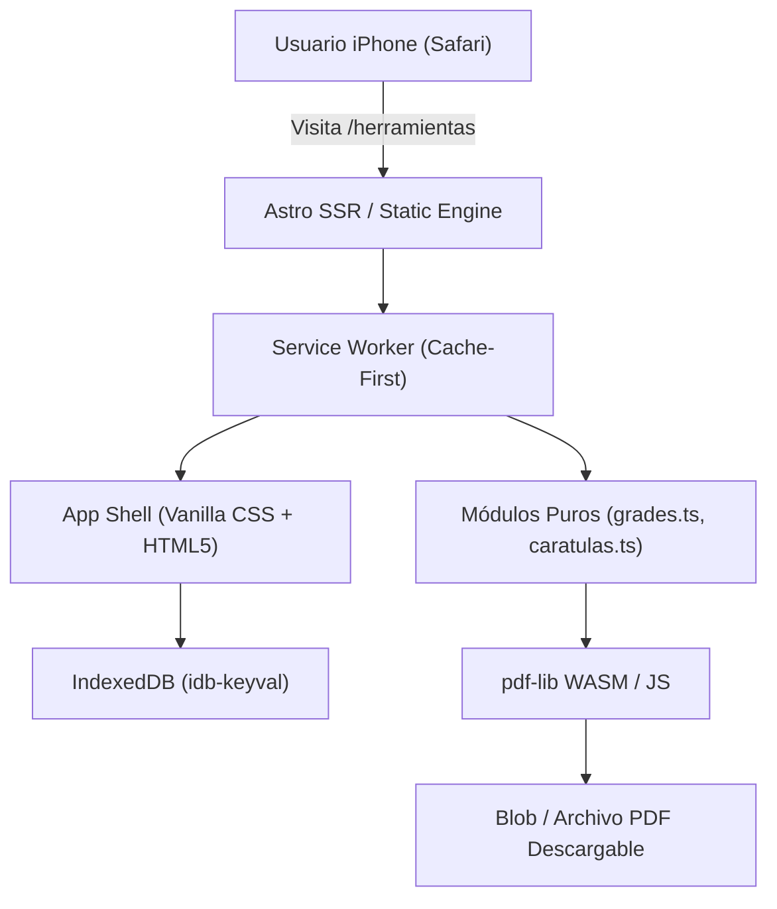

# Plan de Evaluación Técnica: PWA para iOS (iPhone)
**Proyecto:** Pilas! Software Estudiantil  
**Fecha de Evaluación:** 27 de octubre de 2026  
**Autor:** Frontend Engineering Team  
**Estado:** Documento de Planificación Arquitectónica (No implementar todavía)

---

## 1. Contexto y Justificación del Problema

### El Desafío del Ecosistema Apple en Universidades de Ecuador
Pilas! se distribuye actualmente como archivo APK nativo para Android. Si bien la mayoría de los estudiantes universitarios en la ESPE y campus públicos de Ecuador utilizan dispositivos Android (gama media y baja), existe un segmento de estudiantes con dispositivos **Apple iPhone** que no pueden instalar archivos `.apk` debido al ecosistema cerrado de iOS (el cual no permite sideloading fuera de la Unión Europea sin cuentas de desarrollador de Apple, Mac y herramientas como AltStore/SideStore).

Adicionalmente, publicar la app completa en el Apple App Store implicaría:
1. Pagar una suscripción anual de $99 USD (insostenible para un proyecto estudiantil independiente y gratuito).
2. Enfrentar revisiones estrictas de Apple sobre marcas registradas, nombres de universidades ("ESPE") y enlaces institucionales.
3. Riego de rechazo por considerar la conexión con Banner o Moodle como web scraping o servicios no oficiales.

### La Solución Propuesta: Progressive Web App (PWA) Instalable
Convertir las herramientas estudiantiles clave que **no dependen de hardware nativo de Android** (como la calculadora de notas y el generador de carátulas) en una **PWA instalable desde Safari en iOS** ("Añadir a pantalla de inicio").

---

## 2. Alcance Funcional Propuesto

### Herramientas dentro del Alcance (Fase PWA)
| Herramienta | Viabilidad Web / PWA | Justificación Técnica |
| :--- | :--- | :--- |
| **Calculadora de Notas (42/60 pts y Multiescala)** | 🟢 100% Viable | La lógica pura ya está desacoplada en `src/lib/grades.ts` y testeada en Vitest. No requiere APIs nativas ni conexión a internet. |
| **Generador de Carátulas Universitarias Oficiales** | 🟢 100% Viable | Puede implementarse con `pdf-lib` en el navegador. Genera documentos PDF con sellos vectoriales SVG y descarga directa al carrete o archivos de iOS. |
| **Compresor de PDF para Moodle** | 🟡 Parcialmente Viable | WebAssembly (`pdf-lib` o `wasm-imagemagick`) permite recompresión local en cliente, pero en iPhones de gama de entrada (ej. iPhone 8 / SE) el límite de memoria de WebKit puede provocar cuelgues si el PDF supera 30 MB. |
| **Horario y Aulas sin Internet** | 🟢 100% Viable | Visualización de horario precargado mediante importación de archivo JSON exportado o captura de imagen guardada en IndexedDB. |

### Herramientas Fuera de Alcance (Exclusivas de la App Android)
- **Carnet Garita con emulación de códigos de barras de alta frecuencia** (en iOS la pantalla tiene restricciones de brillo forzado por software y no se integra con widgets de pantalla bloqueada sin app nativa).
- **Conexión profunda a Banner con persistencia en Android Keystore** (en iOS WebKit no existe equivalente web para almacenamiento criptográfico protegido por Secure Enclave sin app nativa).
- **Widgets interactivos de escritorio** (iOS no admite widgets web de PWA en el springboard).

---

## 3. Arquitectura Técnica de la PWA

### Componentes de Software


### 1. Manifiesto de Aplicación Web (`manifest.webmanifest`)
```json
{
  "name": "Pilas! Herramientas Estudiantiles",
  "short_name": "Pilas!",
  "description": "Calculadora de notas 42 puntos, carátulas universitarias y herramientas offline para iPhone.",
  "start_url": "/herramientas/?source=pwa_ios",
  "display": "standalone",
  "orientation": "portrait",
  "background_color": "#101319",
  "theme_color": "#FF3FA4",
  "icons": [
    { "src": "/pwa/icon-192.png", "sizes": "192x192", "type": "image/png" },
    { "src": "/pwa/icon-512.png", "sizes": "512x512", "type": "image/png" },
    { "src": "/pwa/icon-maskable.png", "sizes": "512x512", "type": "image/png", "purpose": "maskable" }
  ]
}
```

### 2. Metadatos Específicos para Apple WebKit
Para que iOS reconozca la experiencia nativa de pantalla completa sin barras de navegación del navegador:
```html
<meta name="apple-mobile-web-app-capable" content="yes">
<meta name="apple-mobile-web-app-status-bar-style" content="black-translucent">
<meta name="apple-mobile-web-app-title" content="Pilas!">
<link rel="apple-touch-icon" href="/pwa/apple-touch-icon-180x180.png">
```

### 3. Ajuste de Vista con Safe Area Insets (CSS)
En iOS con Dynamic Island y notch, es obligatorio respetar las áreas seguras:
```css
body {
  padding-top: env(safe-area-inset-top);
  padding-bottom: env(safe-area-inset-bottom);
  padding-left: env(safe-area-inset-left);
  padding-right: env(safe-area-inset-right);
}
```

---

## 4. Estimación de Esfuerzo de Desarrollo

| Fase | Tareas Principales | Esfuerzo Estimado |
| :--- | :--- | :--- |
| **Fase 1: Infraestructura PWA** | Configuración de Service Worker con CacheFirst para fuentes, CSS y scripts; generación de `manifest.webmanifest`; iconos con soporte de `apple-touch-icon` en resoluciones 120, 152, 167 y 180 px. | 2 días laborables |
| **Fase 2: Motor de Carátulas Web** | Integración de `pdf-lib` para renderizar plantillas oficiales con sellos vectoriales SVG en cliente; inputs de título, materia, docente y fecha; generación en menos de 1 segundo. | 3 días laborables |
| **Fase 3: Modal de Guía de Instalación iOS** | Componente flotante que detecte iOS Safari (`/iPad|iPhone|iPod/.test(navigator.userAgent)`) y muestre animación guiada para pulsar el botón "Compartir" de Safari y seleccionar "Añadir a pantalla de inicio". | 1 día laborable |
| **Fase 4: Pruebas y QA en Dispositivos Reales** | Validación en Safari iOS 16, 17 y 18; pruebas de funcionamiento en modo avión (100% offline); verificación de que no existan saltos visuales ni solapamientos con la barra de gestos de iOS. | 2 días laborables |
| **TOTAL ESTIMADO** | **8 días laborables (~1.5 semanas de desarrollo)** | |

---

## 5. Riesgos Técnicos y Limitaciones de iOS WebKit

### 1. Política de Limpieza de Almacenamiento de Apple (7-Day Eviction)
> [!WARNING]
> En iOS Safari, si un usuario no abre la PWA ni interactúa con el dominio durante 7 días consecutivos, WebKit puede purgar automáticamente la memoria caché de IndexedDB y Service Workers.
> **Mitigación:** Diseñar las herramientas para que no dependan de sesiones largas y permitir exportar/importar notas o configuraciones mediante archivos de respaldo JSON ligeros o sincronización opcional con portapapeles.

### 2. Ausencia de Evento `beforeinstallprompt`
En navegadores Android (Chrome), el sistema dispara el evento `beforeinstallprompt` para mostrar un botón nativo de "Instalar App". Apple **no implementa este estándar**, por lo que la interfaz de usuario debe enseñar proactivamente al estudiante a usar el menú de Safari.

### 3. Límites de Memoria para PDFs en Modelos Antiguos
Dispositivos con menos de 3 GB de RAM (como el iPhone 7 u 8) pueden cerrar la pestaña de WebKit si se procesa un archivo PDF grande en memoria JS.
**Mitigación:** Limitar la generación y compresión web de PDFs a archivos de menos de 15 MB con advertencia explícita en pantalla.

---

## 6. Recomendación Estratégica

**No implementar inmediatamente en el sprint actual.**  
La prioridad del proyecto en este semestre es consolidar la experiencia del 85%+ del estudiantado en Android (gama media/baja). Sin embargo, la estructura creada en la **Fase 4** (con `src/lib/grades.ts`, `src/lib/academic.ts` y componentes desacoplados) deja el terreno preparado para que la PWA de iOS sea un paso natural en el siguiente ciclo semestral (2026-B) con un coste de implementación mínimo y cero fricción arquitectónica.
